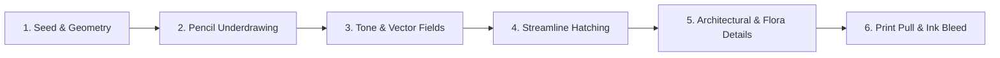

# burin ✒️

> **Generative landscape engravings in the dramatic style of Gustave Doré, algorithmically composed from a single seed and etched stroke-by-stroke in real time.**

[](https://diogo7dias.github.io/burin/)
[](https://github.com/diogo7dias/burin)
[](LICENSE)

Each seed picks a scene (lake and castle, dark wood, gorge, ruined abbey, stormy headland), sometimes by moonlight, sometimes as a tall plate. The plate is sketched in pencil, then hatched in three passes of pen strokes, detailed, and pulled as a print. The seed lives in the URL, so any plate can be shared.

## 🌐 Experience the Project

### **[👉 Launch the Live Interactive Engraver](https://diogo7dias.github.io/burin/)**

Every seed generates a completely distinct, deterministic engraving drawn before your eyes—first in graphite pencil underdrawing, then carved with pen and burin across multiple crosshatching passes, and finally pulled as a finished ink print on aged paper.

---

## ✨ Features

- **Seeded Determinism:** Every plate is derived strictly from a numerical seed. Re-visiting the same seed (or sharing the URL hash) reproduces the exact same scene.
- **Stroke-by-Stroke Animation:** Watch the plate evolve through simulated multi-hand engraving passes over ~60 seconds, or finish instantaneously with the tap of a key.
- **Doré Chiaroscuro & Tone Mapping:** Light pools dramatically on points of interest (castles, ruins, waterfalls, sun rays) while valleys and crags sink into deep crosshatched shadow.
- **Streamline-Driven Hatching:** Shading lines follow the curvature of each surface: down rock falls, along cloud bellies, through leaves, and along the road. Each line then leaves that even gap.
- **No build step:** Static HTML and JavaScript. Streamlines and perfect-freehand load from a CDN.

---

## 🌄 The Five Scene Typologies

Depending on the seed, *burin* constructs one of five classical romantic compositions, choosing between landscape and portrait plate formats:

| Scene | Motif & Composition |
| :--- | :--- |
| 🏰 **The Tower by the Lake** | Mountain crags, distant alpine ridges, fortified towers reflected in still water, and wandering riders. |
| 🌲 **The Dark Wood** | Deep forested canopy, tiered rows of ancient trunks fading into mist, and piercing god rays. |
| 🌉 **The Bridge over the Gorge** | Sheer cliffs flanking a chasm, an arched stone bridge, plunging waterfall, and sea mist. |
| ⛪ **The Ruined Abbey** | Fractured gothic gables, tracery lancet windows, overgrown ivy, and scattered foreground gravestones. |
| 🌊 **The Headland in the Storm** | A battered coastal keep atop sea cliffs, breaking storm waves, offshore sea stacks, and solitary watchers. |

---

## 🎨 The Engraving Pipeline

*Burin* simulates how a master 19th-century engraver crafted an intaglio plate:



1. **Scene Composition:** Procedurally calculates horizon heights, sun/moon positions, mountain profiles via fractal Brownian motion (fBm), structures, trees, figures, and roads.
2. **Pencil Underdrawing:** Light, searching graphite strokes overshoot contours, sketching the initial layout.
3. **Tone Map & Vector Direction Fields:** A multi-layered tone mask establishes local light values and directional tangent fields for each surface type.
4. **Hatching Passes (1/3, 2/3, 3/3):** The first pass follows the form. The darker passes cut across it, and only once the tone is shadow. Each line then shifts off its gap, swells through the stroke, and lifts on its own length. Water stays a ripple. The burin is held at 45°: a hairline along the blade, heavy across it.
5. **Fine Engraving Details:** Fissures in rock faces, ashlar masonry courses, ivy tendrils, grass blades, birds in flight, and shaded figures.
6. **Pulling the Print:** Simulates ink absorption into rag paper, pooling in dense hatching and leaving micro-speckles across solid blacks.

---

## ⌨️ Controls & Shortcuts

| Key / Action | Action |
| :--- | :--- |
| <kbd>n</kbd> | Generate a **New Plate** (picks a fresh random seed) |
| <kbd>Space</kbd> or Click Plate | **Finish immediately** (skips the stroke animation) |
| <kbd>s</kbd> | **Save high-resolution PNG** of the current engraving |
| `#<number>` (URL Hash) | Load any specific seed directly (e.g. `index.html#42`) |

---

## 🛠️ Running Locally

The project consists entirely of static files (`index.html`, `draw.js` and the parts in `engraver/`) with zero build dependencies. `index.html` loads the `engraver/*.js` parts with plain script tags before `draw.js`, which exposes the `Engraver` API; under Node, `draw.js` requires the parts itself.

### 1. Clone the Repository
```sh
git clone https://github.com/diogo7dias/burin.git
cd burin
```

### 2. Start Local Web Server
Serve the repository root with any HTTP server:

```sh
# Python 3
python3 -m http.server 8000

# or Node (npx)
npx serve .
```
Then open `http://localhost:8000` in your web browser.

### 3. Run Automated Tests
A suite of determinism, variety, and geometric regression tests is included:

```sh
node test.js
```

---

## The pen

The same seed still finishes as the same plate. What changed is the cut:

- The blade is held at 45°. Along it the width factor is `0.45`. Across it the width factor is `1.31`.
- Each ink stroke picks its own attack and lift from the seed.
- Hands in one pass are staggered, so they are not on one clock. Skipping to the end does not change the plate.
- Pencil marks and the small detail cuts use [perfect-freehand](https://github.com/steveruizok/perfect-freehand) 1.2.3. Hatch and outlines stay filled ribbons.
- The first hatch pass follows the form. Pass 2 cuts across it (`π/2`) once darkness reaches `0.55`. Pass 3 cuts across and a little off the square (`π/2 + 0.45`) from `0.75`. Water keeps a ripple (`0`, `0.2`, `-0.2`) instead of a net. Each whole line then shifts by up to `0.675` of the layer gap and bows by up to `0.225`. Width is multiplied by `0.55` at the ends and `1.35` in the middle. Castle walls and far hills turn less (`0.16` against `0.5`), so the building stays straight.

## 📚 Credits & Acknowledgements

- **Hatching Streamlines:** Powered by [@anvaka/streamlines](https://github.com/anvaka/streamlines) 1.6.0, implementing Jobard-Lefer streamline placement.
- **Pencil and detail marks:** [perfect-freehand](https://github.com/steveruizok/perfect-freehand) 1.2.3, MIT.
- **Aesthetic Inspiration:** The dramatic biblical and literary wood engravings of [Gustave Doré](https://en.wikipedia.org/wiki/Gustave_Dor%C3%A9) (1832–1883).

---

## 📄 License

This project is licensed under the [MIT License](LICENSE).
